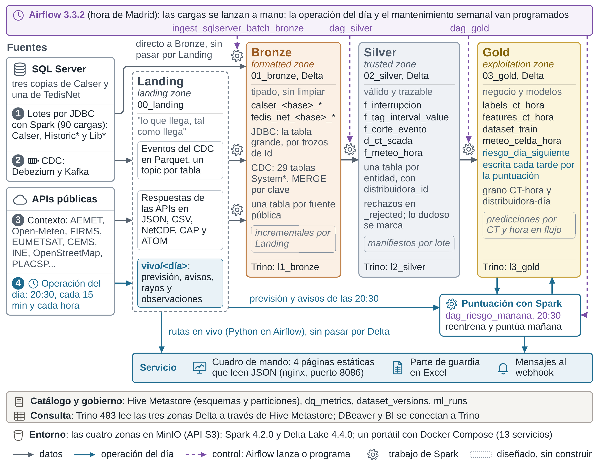

# GridPredic Infra

Entorno local de desarrollo para ejecutar la plataforma de datos de GridPredic con Docker Compose.

GridPredic es el TFM de Josep Morancho i Poyatos y Anton Shebarshinov Polenyaka en el Máster en Data Science and Engineering de la UPC School (2025-2026): un sistema que dice cada tarde qué riesgo de interrupción de suministro tiene al día siguiente la red de media tensión de una distribuidora eléctrica, en qué franja horaria, en qué líneas y dónde dejar las brigadas, a partir del histórico de interrupciones (aplicación Calser), de la telemetría del SCADA TedisNet, de la previsión meteorológica y de los avisos de AEMET; la pregunta original, el aviso de 1 a 3 horas por CT, se midió y se descartó como alerta (ver [docs/model_card.md](docs/model_card.md)). Este repositorio contiene la plataforma de datos y el pipeline que construye el dataset, de Landing a Gold, el entrenamiento y la evaluación de los modelos, la operación diaria en Airflow con su cuadro de mando y el caso de negocio con los datos reales de 2022 - 2026.

## Para la evaluación

- La versión entregada con la memoria (M7, 26.10.2026) es la etiqueta `v0.16.0` de este repositorio; el [CHANGELOG](CHANGELOG.md) dice qué entró en cada versión y [CITATION.cff](CITATION.cff) cómo citarlo.
- La memoria dice de dónde sale cada cifra: [docs/cifras.md](docs/cifras.md) da, para cada una, el documento y la ejecución que la produce, y `experimentos/` guarda los guiones con sus salidas.
- Sin levantar el stack se puede revisar el código y correr las pruebas (apartado 14): `pip install -r requirements.txt`, `make lint` y `make test` (363 pruebas a 23.10.2026, de Landing a los modelos y al plan financiero), lo mismo que ejecuta la integración continua.
- El cuadro de mando con una copia congelada de datos está en https://gridpredic.com/demo/ (las tres redes como Distribuidora 1, 2 y 3); la página pública, en https://gridpredic.com.
- Las copias de Calser y TedisNet no se distribuyen (confidencialidad, licencia y más de 60 GB): para repetir la carga completa hacen falta en un entorno controlado, siguiendo los apartados 1 a 13. El grafo de la red para la defensa se levanta aparte (apartado 8, Neo4j).

## Documentación

| Documento | Qué cuenta |
| --- | --- |
| [docs/dataset_card.md](docs/dataset_card.md) | Ficha del dataset (formato Hugging Face): fuentes, volumen, estructura por zonas, target, sesgos, versionado |
| [docs/model_card.md](docs/model_card.md) | Ficha del modelo (formato Hugging Face): uso previsto y excluido, features, métricas y criterios de aceptación |
| [docs/silver-layer.md](docs/silver-layer.md) | Reglas de la capa Silver, tabla a tabla, y por qué |
| [docs/gold-layer.md](docs/gold-layer.md) | Capa Gold: etiquetas, features, dataset de entrenamiento y sus decisiones |
| [docs/ml-training.md](docs/ml-training.md) | Entrenamiento y evaluación de los modelos (XGBoost, Random Forest, logística y referencias) |
| [docs/ml-riesgo-dia.md](docs/ml-riesgo-dia.md) | El riesgo del día siguiente, el modelo que corre cada tarde: etiquetas, bloques de variables, horizontes, variantes y salidas |
| [docs/causas-incidencias.md](docs/causas-incidencias.md) | Las causas de todas las incidencias de Calser, qué datos podrían anunciar cada una, las fuentes públicas añadidas y los comandos de esos jobs y de la operación |
| [docs/network-analysis.md](docs/network-analysis.md) | Análisis de la red: de dónde sale el TIEPI, dónde se repite, dónde compensa el telemando, cuánto dinero hay detrás, el riesgo anual por CT y cabecera y los datos públicos |
| [docs/project-structure.md](docs/project-structure.md) | Estructura del repositorio y su relación con Cookiecutter Data Science |
| [docs/caso-de-negocio.md](docs/caso-de-negocio.md) | Lo que habría dicho el sistema cada tarde desde 2022 y lo que pasó: resultados, guardia a igual presupuesto, frente a los avisos de AEMET y lo que vale |
| [docs/operacion-diaria.md](docs/operacion-diaria.md) | Manual de la operación en marcha: los DAG, sus horas, lo que dejan, los avisos y qué mirar si falla |
| [docs/cifras.md](docs/cifras.md) | Las cifras que van a la memoria y a la presentación, en una página, con el documento y la ejecución de la que sale cada una |
| [docs/memoria-texto-experimentos.md](docs/memoria-texto-experimentos.md) | Borrador del apartado de resultados de la memoria sobre las pruebas de mejora del modelo del día (método, revisión de literatura, las dieciséis pruebas con su PR-AUC, el arbolado y el riesgo a 48 y 72 h), listo para pegar |
| [docs/revision-literatura.md](docs/revision-literatura.md) | Revisión de la literatura (modelos de interrupciones por meteorología, 2012 - 2026, con los DOI comprobados), las fuentes públicas que no usamos todavía y las ideas de modelado con respaldo, con las cinco pruebas recomendadas |
| [docs/investigacion-continua.md](docs/investigacion-continua.md) | Cuaderno de laboratorio: las hipótesis probadas con los datos (literatura, humedad del suelo y duración del viento, datos públicos, dispositivos de los clientes), cómo se probaron y qué se descartó; el código de cada prueba está en `experimentos/` |
| [docs/licencias.md](docs/licencias.md) | Inventario de licencias de lo que se instalaría en una distribuidora: imágenes, librerías y lo que sirve el cuadro de mando, con la obligación de cada una y el riesgo de MinIO |
| [CONTRIBUTING.md](CONTRIBUTING.md) | GitHub Flow tal como lo aplicamos, reglas de commits y versionado de datos |
| [CHANGELOG.md](CHANGELOG.md) | Historial de versiones |

## Estructura del repositorio

```text
├── compose.yaml            # Servicios, dependencias y montajes
├── .env.example            # Plantilla de credenciales
├── requirements.txt        # Entorno local para tests y linter (sin Docker)
├── pyproject.toml          # Configuración de ruff y pytest
├── Makefile                # Atajos: make up, make test, make lint...
├── .github/                # Plantillas de PR e issues, CODEOWNERS y CI
├── infra/                  # Dockerfiles, configuración y scripts por componente
├── etl/
│   ├── dags/               # Orquestación con Airflow
│   ├── config/             # Parámetros de los procesos
│   └── jobs/               # Ingesta, transformación y modelos con Spark
├── data/reference_data/    # Datos de referencia pequeños (municipios)
├── dashboard/              # Cuadro de mando estático (lo sirve el contenedor dashboard)
├── web/                    # Página pública de GridPredic.com, estática
├── docs/                   # Cards, capas Silver y Gold, modelos, operación, diagrama de la arquitectura
├── experimentos/           # Código de las pruebas del cuaderno de laboratorio
├── notebooks/              # Exploración (convención en su README)
├── tests/                  # Pruebas locales de los jobs
└── _runlogs/               # Scripts de pruebas manuales y de operación (los logs se ignoran)
```

La estructura sigue la idea de Cookiecutter Data Science adaptada a un pipeline que corre en Spark y Airflow: la correspondencia carpeta a carpeta está en [docs/project-structure.md](docs/project-structure.md).

Dentro de `dags/`, `config/` y `jobs/`, los archivos se agrupan por **capa de destino**: `00_landing/`, `01_bronze/`, `02_silver/`, `03_gold/` y `04_ml/` (modelos, análisis y operación de cada tarde). Solo se crean las carpetas que contienen archivos.

Los nombres identifican el **tipo**, la **capa** y el **origen** (Landing/Bronze) o la **entidad** (Silver/Gold). Solo los jobs de Landing y Bronze añaden `batch` o `streaming`:

```text
dag_bronze_sqlserver.py
config_bronze_sqlserver.json
job_bronze_sqlserver_batch.py
job_silver_d_salida.py
```

## Flujo de datos



> El diagrama es la arquitectura implementada: el repositorio cubre la ingesta de SQL Server en batch y streaming hasta Bronze, la de la meteorología y las fuentes públicas, la capa Silver completa (apartado 11), la capa Gold hasta el dataset de entrenamiento versionado (apartado 12), el entrenamiento de los modelos y la operación de cada tarde con su cuadro de mando (apartado 13).

## Stack tecnológico

| Área | Tecnología | Función |
| --- | --- | --- |
| Fuentes | **SQL Server 2022** | Bases de datos operacionales y fuentes batch |
| Fuentes externas | **APIs públicas** | Meteorología de Open-Meteo, avisos, predicción y estaciones de AEMET, rayos de EUMETSAT y datos públicos |
| CDC y mensajería | **Debezium, Kafka, Kafka Connect** | Captura y transporte de los cambios de SQL Server en flujo, con segundos de retraso |
| Orquestación | **Apache Airflow** | Cargas batch, operación de cada tarde y mantenimiento semanal de las tablas Delta |
| Procesamiento | **Apache Spark 4 + Delta Lake** | Ingesta streaming/batch, transformaciones Bronze -> Silver -> Gold y entrenamiento de los modelos (scikit-learn y XGBoost en el driver) |
| Almacenamiento | **MinIO** | Object Storage compatible con S3 para Landing y Delta Lake |
| Catálogo | **Hive Metastore + PostgreSQL** | Catálogo compartido de las tablas Delta |
| Consulta | **Trino** | Motor SQL sobre el lakehouse |
| Operación | **Kafka UI + Spark History Server** | Inspección de Kafka y ejecuciones Spark |
| Cuadro de mando | **nginx + Leaflet** | Páginas estáticas del riesgo sobre OpenStreetMap (apartado 13) |

> **Nota sobre la imagen de MinIO.** MinIO dejó de publicar sus imágenes community en Docker Hub en octubre de 2025, por lo que `minio/minio` ya no puede descargarse de allí. El síntoma al levantar el stack es un error engañoso, porque habla de permisos cuando en realidad el repositorio no existe:
>
> ```text
> Error response from daemon: pull access denied for minio/minio,
> repository does not exist or may require 'docker login'
> ```
>
> Durante un tiempo sirvió Quay (`quay.io/minio/minio`), pero a finales de septiembre de 2026 ese repositorio también pasó a pedir autenticación y el pull falla con:
>
> ```text
> failed to resolve reference "quay.io/minio/minio:RELEASE.2025-09-07T16-13-09Z":
> unexpected status from HEAD request ... 401 UNAUTHORIZED
> ```
>
> El `compose.yaml` usa ahora la imagen de Pigsty, un fork mantenido del servidor MinIO, con un release fijo en lugar de `latest` para que el entorno sea reproducible:
>
> ```yaml
> image: pgsty/minio:RELEASE.2026-08-04T00-00-00Z
> ```
>
> Es un reemplazo directo: mismo binario `minio`, mismas variables `MINIO_ROOT_USER` y `MINIO_ROOT_PASSWORD`, y trae el cliente `mc` del que dependen los scripts de `infra/minio/`.

### Lo mismo en la nube

Todo corre en un portátil con Docker, con las copias de las bases de las distribuidoras en local. Cada pieza tiene un servicio gestionado equivalente, y las capas, los formatos (Delta sobre almacenamiento de objetos) y los trabajos no cambiarían:

| Pieza local | En AWS | En Azure |
| --- | --- | --- |
| MinIO | Amazon S3 | Azure Data Lake Storage Gen2 |
| Spark 4 + Delta Lake | Amazon EMR o Databricks | Azure Databricks |
| Hive Metastore | AWS Glue Data Catalog | Unity Catalog de Databricks |
| Trino | Amazon Athena | Databricks SQL o Synapse serverless |
| Airflow | Amazon MWAA | Airflow gestionado de Data Factory o de Fabric |
| Debezium, Kafka Connect y Kafka | Amazon MSK con MSK Connect | Event Hubs con su interfaz de Kafka y Debezium |
| nginx con las páginas estáticas | S3 con CloudFront | Azure Static Web Apps |

SQL Server sigue en la distribuidora en cualquier caso: la captura de cambios y las cargas por lotes llegarían por una conexión privada.

### Por qué los modelos van en el driver y no en MLlib

Spark hace el trabajo pesado: leer las series del SCADA, los cortes y la meteorología y dejarlos en features por CT y hora o por distribuidora y día. Los modelos se entrenan después con scikit-learn y XGBoost en el driver, pasando de Spark a pandas con Arrow, porque las tablas son pequeñas: la del modelo del día son unos 8.200 días de red por 35 variables, 2,3 MB, y su logística se ajusta en milisegundos; la muestra del modelo por CT, 884.971 filas por 246 variables, ocupa unos 0,9 GB en float32, poco al lado de los 6 GB que `train.sh` da al driver. spark.ml tendría la logística, pero no el XGBoost con parada temprana sobre la PR-AUC de una muestra ponderada ni la evaluación hacia delante con purga entre años. Lo que sí se reparte es la puntuación: el modelo se envía a los ejecutores y valid se puntúa por lotes con `mapInPandas`. Además, scikit-learn permite probar cada modelo sin clúster, en segundos. Si un día el volumen lo pidiera (todas las líneas de una distribuidora grande por hora), el paso sería `xgboost.spark` o un modelo por grupo con `applyInPandas`, sin tocar las capas.

Los modelos están en Python y no en R. Python es el lenguaje de todo el camino hasta la guardia, y la tubería de scikit-learn que evaluamos por años es la misma que se reentrena cada tarde. Sobre Spark 4, R habría sido una capa más, porque SparkR está en desuso desde la versión 4.0. R nos ha servido de referencia: el perfil de los días con avería sigue a FactoMineR y la logística de Firth (`logistica_firth` de `ml_models.py`), al algoritmo de logistf, las dos programadas en Python y comprobadas.

---

## 1. Requisitos mínimos del ordenador

Para ejecutar todo el stack localmente:

- **CPU:** 4 cores.
- **RAM:** 16 GB.
- **Disco libre:** al menos **350 GB**, repartidos según el desglose siguiente.

Se recomienda asignar a Docker Desktop al menos **4 CPU y 12 GB de RAM**.

### 1.1 Desglose del espacio en disco

| Concepto | Dónde se almacena | Tamaño aproximado |
| --- | --- | --- |
| Los cuatro backups `.bak` | Carpeta del repositorio | Unos 66 GB (61,4 GiB) |
| `sqlserver-data` (las cuatro bases restauradas) | Disco virtual de Docker | 200 - 250 GB |
| `minio-data` (Landing y Delta Lake, crece con el uso) | Disco virtual de Docker | 50 GB en adelante |
| Imágenes y caché de construcción (Spark, Hive, Airflow, Trino, Kafka) | Disco virtual de Docker | 25 - 35 GB |
| `kafka-data`, `airflow-data`, `hive-db` | Disco virtual de Docker | 5 - 10 GB |

La mayor parte del consumo no cae en la carpeta del repositorio, sino en el **disco virtual de Docker**, que por defecto se crea en la unidad del sistema. Si esa unidad va justa de espacio, hay que moverlo antes del primer arranque: ver el apartado 3.

---

## 2. Software necesario

Instalar únicamente:

- **Git**
- **Docker Desktop**
- **Docker Compose >= 2.30.0** (`docker compose`)

Comprobación rápida:

```bash
git --version
docker --version
docker compose version
```

---

## 3. Ubicar los datos de Docker fuera del disco del sistema

**Motivo.** Los volúmenes declarados en `compose.yaml` (`sqlserver-data`, `minio-data`, `kafka-data`, `airflow-data`, `hive-db` y las cachés de Ivy `ivy-spark-master` e `ivy-airflow`) no son carpetas del sistema de archivos del anfitrión: viven dentro del **disco virtual de Docker**, junto con las imágenes y la caché de construcción. Ese disco se crea por defecto en la unidad del sistema, con independencia de dónde esté clonado el repositorio. Con `TedisNet_GridPredic` restaurada, el disco virtual de Docker entero supera holgadamente los 250 GB, de modo que si la unidad del sistema no dispone de ese margen el arranque se interrumpe a media restauración y hay que empezar de cero.

**Windows (Docker Desktop).** Antes del primer arranque:

1. Detener el stack, si estuviera levantado:

   ```bash
   docker compose down
   ```

2. Crear la carpeta destino en la unidad con espacio, por ejemplo `D:\DockerData`.
3. Abrir Docker Desktop -> Settings -> Resources -> Advanced -> "Disk image location" y seleccionar esa carpeta.
4. Pulsar Apply & restart. Docker mueve el disco virtual y reinicia su máquina virtual.

Comprobación desde PowerShell:

```powershell
Get-ChildItem D:\DockerData -Recurse -Filter *.vhdx |
    Select-Object FullName, @{n='GB';e={[math]::Round($_.Length/1GB,2)}}
```

Debe aparecer `docker_data.vhdx` en la ruta elegida.

**macOS (Docker Desktop).** Misma opción: Settings -> Resources -> Advanced -> "Disk image location".

**Linux.** Ajustar `data-root` en `/etc/docker/daemon.json` y reiniciar el servicio:

```json
{
  "data-root": "/mnt/datos/docker"
}
```

El cambio es global de Docker, no específico de este proyecto: afecta a todas las imágenes y volúmenes de la máquina.

---

## 4. Clonar el repositorio

```bash
git clone https://github.com/antonpolenyaka/gridpredic-infrastructure.git
cd gridpredic-infrastructure
```

Todos los comandos siguientes se ejecutan desde la raíz del repositorio.

---

## 5. Añadir los backups de SQL Server

Crear, si no existe, la carpeta:

```text
infra/sqlserver/backups/
```

Copiar dentro los cuatro backups (las tres copias de Calser y la de TedisNet) con los nombres de fichero que espera `infra/sqlserver/scripts/restore_databases.sql`, que es también el que fija el nombre de cada base al restaurarla. Los nombres reales de las distribuidoras no aparecen en la documentación: en todo lo visible son la Distribuidora 1, la 2 y la 3, y las bases se llaman aquí `TedisNet_GridPredic` y `Calser_Distribuidora1`, `Calser_Distribuidora2` y `Calser_Distribuidora3`. Los nombres con los que se restauran están en ese script, en `etl/config/01_bronze/config_bronze_sqlserver.json` y en el conector de `infra/kafka-connect/connectors/`; cuando un comando de esta guía necesita uno, lleva un marcador entre `< >`.

---

## 6. Crear el archivo `.env`

Duplicar `.env.example` como `.env`:

```bash
cp .env.example .env
```

Y configurar las credenciales locales:

```dotenv
HIVE_METASTORE_DB_PASSWORD=<PASSWORD>
MINIO_ROOT_USER=<USER>
MINIO_ROOT_PASSWORD=<PASSWORD>
MSSQL_SA_PASSWORD=<PASSWORD>
```

`MSSQL_SA_PASSWORD` debe cumplir la política de complejidad de SQL Server.

> **No utilizar el carácter `$` en las contraseñas.** Compose interpola variables también dentro del propio `.env`, de manera que una contraseña como `hM7#kL9$vE2@wQ4x` se resuelve como `hM7#kL9@wQ4x`: el servicio se inicializa con una contraseña distinta de la escrita y a partir de ahí nada cuadra. El síntoma es un aviso al ejecutar cualquier comando de Compose:
>
> ```text
> WARN[0000] The "vE2" variable is not set. Defaulting to a blank string.
> ```
>
> Si se necesita un `$` literal hay que duplicarlo (`$$`).

Antes de arrancar conviene verificar que las contraseñas se resuelven enteras y que no aparece ningún aviso:

```bash
docker compose config
```

---

## 7. Levantar la infraestructura

```bash
docker compose up -d --build --wait
```

Kafka, Kafka Connect y Kafka UI van en el perfil `cdc` y no arrancan con el resto: la captura de TedisNet está parada desde la carga inicial del 08.10.2026 y así un reinicio del portátil no espera a que se recuperen. Para la ingesta en flujo, `docker compose --profile cdc up -d --wait`.

Para arrancar y parar todo en orden, sin hacerlo servicio a servicio, hay un script por sistema en la raíz del repositorio:

| Sistema | Arrancar | Parar |
| --- | --- | --- |
| Windows (PowerShell 7 y Docker Desktop) | `pwsh -File D:\GitHub\gridpredic-infrastructure\startGridPredic_windows.ps1` | `pwsh -File D:\GitHub\gridpredic-infrastructure\stopGridPredic_windows.ps1` |
| Linux (Docker Engine o Desktop con compose) | `./startGridPredic_linux.sh` | `./stopGridPredic_linux.sh` |

El de arranque levanta el stack por fases y espera a que cada una esté sana, deja SQL Server para el final sin esperarlo y, en Windows, abre Docker Desktop si hace falta y arranca la cola y el vigilante. Con `-Cdc` (Windows) o `--cdc` (Linux) arranca también el perfil `cdc`. El de parada no para si la cola o Spark tienen algo en marcha o si es la franja de la tarde (salvo con `-Forzar` o `--forzar`). Los detalles están en [docs/operacion-diaria.md](docs/operacion-diaria.md), apartado 5.

El grafo de la red en Neo4j, para enseñarlo en la defensa, va aparte y no arranca con el stack. Tiene sus propios scripts, también en la raíz (apartado 8, "Neo4j"):

| Sistema | Arrancar | Parar |
| --- | --- | --- |
| Windows (PowerShell 7 y Docker Desktop) | `pwsh -File D:\GitHub\gridpredic-infrastructure\startNeo4j_windows.ps1` | `pwsh -File D:\GitHub\gridpredic-infrastructure\stopNeo4j_windows.ps1` |
| Linux (Docker Engine o Desktop) | `./startNeo4j_linux.sh` | `./stopNeo4j_linux.sh` |

Los `healthchecks` y las dependencias del Compose controlan el orden de inicialización. Cuando el comando termina correctamente, el entorno está listo para utilizarse.

El primer arranque es largo. Como referencia, en un portátil con 4 cores y 12 GB asignados a Docker:

| Fase | Duración aproximada |
| --- | --- |
| Descarga de imágenes y construcción de Spark, Hive y Airflow | 10 - 15 min |
| Restauración de las cuatro bases en SQL Server | 60 - 70 min |
| Resolución de dependencias de Spark en `spark-master` | 10 min |

La restauración manda: el backup de `TedisNet_GridPredic` son 63,5 GB y se lee desde una ruta del anfitrión montada en la máquina virtual de Docker, a unos 60 MB/s. Por eso el healthcheck de `sqlserver` tiene un `start_period` de 90 minutos (hasta entonces las sondas fallidas no cuentan; después, cinco seguidas marcan el contenedor como `unhealthy`).

Los `start_period` de los healthchecks están dimensionados para ese primer arranque. Si se reducen, Compose da por fallidos servicios que en realidad están inicializándose y aborta la cadena de dependencias, aunque los contenedores acaben levantando solos.

En la resolución de dependencias de Spark se descargan unos 320 jars de Maven Central, entre `spark.jars.packages` y `spark.sql.hive.metastore.jars maven`. Esa caché se guarda en los volúmenes `ivy-spark-master` e `ivy-airflow`, de forma que solo se paga una vez y sobrevive a la recreación de los contenedores. Son dos volúmenes separados a propósito: Ivy no usa bloqueo de ficheros por defecto y los dos servicios pueden resolver a la vez.

Durante el arranque se realiza automáticamente:

- construcción de las imágenes locales de **Spark**, **Hive** y **Airflow**;
- creación de los buckets `datalake` y `spark-events` en **MinIO**;
- arranque de **PostgreSQL** y **Hive Metastore**;
- creación de los schemas `l1_bronze`, `l2_silver` y `l3_gold`;
- restauración de las cuatro bases de datos en **SQL Server**;
- activación de **CDC** sobre las tablas configuradas de `TedisNet_GridPredic`;
- arranque del clúster **Spark**, **Airflow**, **Trino**, **Spark History Server** y el cuadro de mando (**nginx**);
- solo con `--profile cdc`: arranque de **Kafka**, registro del conector de TedisNet (`infra/kafka-connect/connectors/`) en **Kafka Connect** y **Kafka UI**.

---

## 8. Puertos y herramientas de acceso

| Servicio | Dirección | Uso |
| --- | --- | --- |
| SQL Server | `localhost:14330` (`SQLSERVER_PORT`) | Acceso a las cuatro bases de datos; dentro de Docker, `sqlserver:1433` |
| Spark UI de un job en marcha | http://localhost:4040 (lanzado desde Airflow) y http://localhost:4041 (lanzado a mano en `spark-master`) | Etapas y tareas del job mientras corre |
| Spark Master | http://localhost:8080 por defecto; 8090 en el portátil, con `SPARK_MASTER_UI_PORT` | Estado del clúster Spark |
| Spark Worker | http://localhost:8081 | Estado del worker Spark |
| Kafka UI | http://localhost:8082 | Topics, mensajes y estado de Kafka Connect (solo con `--profile cdc`) |
| Airflow | http://localhost:8084 | Gestión y ejecución de DAGs |
| Trino | http://localhost:8085 | Endpoint/UI del motor SQL |
| Cuadro de mando del riesgo | http://localhost:8086 | El riesgo de mañana por distribuidora, línea y municipio sobre un mapa (ver apartado 13) |
| MinIO Console | http://localhost:9001 | Navegación por buckets y objetos |
| Spark History Server | http://localhost:18080 | Histórico de aplicaciones Spark |
| Neo4j Browser y Bolt | http://localhost:7474 y `localhost:7687` | El grafo de la red para la defensa (solo con `startNeo4j_*`) |

> **Si algún puerto está ocupado en tu máquina.** El puerto 8080 de la UI de Spark Master es configurable desde el `.env` con `SPARK_MASTER_UI_PORT`, porque en Windows suele estar tomado por IIS u otro servicio sobre `http.sys`. El síntoma al levantar el stack es:
>
> ```text
> Error response from daemon: ports are not available: exposing port TCP
> 127.0.0.1:8080 -> 127.0.0.1:0: listen tcp 127.0.0.1:8080: bind: An attempt was
> made to access a socket in a way forbidden by its access permissions
> ```
>
> Para comprobar quién lo tiene, en PowerShell como administrador:
>
> ```powershell
> Get-NetTCPConnection -LocalPort 8080 | Select-Object State, OwningProcess
> netsh interface ipv4 show excludedportrange protocol=tcp
> ```
>
> Un `OwningProcess` igual a 4 significa que lo retiene el kernel por una reserva de `http.sys`. Lo más rápido es dejarlo estar y asignar otro puerto en el `.env`:
>
> ```dotenv
> SPARK_MASTER_UI_PORT=8090
> ```

### SQL Server - SSMS

Conectar con **SQL Server Management Studio (SSMS)**:

```text
Server: localhost,14330
Authentication: SQL Server Authentication
Login: sa
Password: <valor de MSSQL_SA_PASSWORD>
```

### Trino - DBeaver

Crear una conexión **Trino** en DBeaver:

```text
Host: localhost
Port: 8085
Database/Schema: lakehouse
Username: <cualquier valor>
Driver properties: timezone=UTC
```

La propiedad `timezone=UTC` importa. Las horas del lago son las horas locales de Calser y TedisNet guardadas como UTC (apartado 1 de [docs/gold-layer.md](docs/gold-layer.md)), Trino convierte un literal sin zona, como `TIMESTAMP '2025-01-01 00:00:00'`, con la zona de la sesión, y el controlador JDBC toma por defecto la de la JVM del cliente: con DBeaver en hora de Madrid, ese filtro empezaría una o dos horas antes en las horas del lago.

No hay autenticación por contraseña configurada para Trino en este entorno local, y por eso `compose.yaml` publica su puerto solo en `127.0.0.1:8085`, como el resto de consolas de administración (MinIO, Spark y Kafka UI): desde otro equipo de la red no responde. Antes de abrirlo a nadie más habría que activar TLS, la autenticación por contraseña (o la del directorio de la distribuidora) y el control de acceso por reglas de Trino, con un rol de solo lectura sobre `l3_gold` para los analistas y las herramientas de BI (el cuadro de mando no pasa por Trino) y Bronze y Silver reservados a los trabajos, que ya acceden por Spark y no por Trino.

Tiempos de consulta medidos el 17.10.2026 en el portátil, con el tiempo del propio servidor (`system.runtime.queries`), en frío y en caliente (mediana de cinco), antes y después de compactar `dataset_train` (apartado 12; detalle en [docs/cifras.md](docs/cifras.md) y en `experimentos/consultas_trino/salida/`):

| Consulta | Filas | Tiempo |
| --- | --- | --- |
| Recuento de `l3_gold.dataset_train` por conjunto (`split`) | 61,8 millones | 7,5 s y 4,8 s; 1,1 s con la tabla compactada |
| Un mes de una distribuidora en `l3_gold.dataset_train` (filtro por `distribuidora_id` y `hora`) | 546.066 | 5,3 s y 1,1 s; 0,8 s compactada |
| Racha máxima de cada celda en `l3_gold.meteo_celda_hora` | 3,6 millones | 4,5 s y 0,8 s |
| Las filas del riesgo de la última tarde en `l3_gold.riesgo_dia_siguiente` | 21 | 2,1 s y 0,5 s |

El cuadro de mando no pasa por Trino: lee los ficheros que deja cada tarde en `dashboard/data`.

Desde la 0.16.0 el contenedor de Trino tiene un tope de 4 GB (`mem_limit` en `compose.yaml`). Sin él, la JVM se reservaba el 80 % de la máquina virtual de Docker, unos 18,8 GiB en el portátil, que compartía con Spark, SQL Server y el resto del stack. Con el tope, el heap máximo es de 3,2 GiB (medido con jcmd); el 20.10.2026 Trino usaba 1 GiB en reposo y hasta 3,1 GiB después de la consulta c5b, el join de `dataset_train` con la meteorología.

### MinIO

Acceder a `http://localhost:9001` con `MINIO_ROOT_USER` y `MINIO_ROOT_PASSWORD`.

### Neo4j

El grafo de la red con el que trabajan los guiones de `experimentos/topologia`, cargado en Neo4j 5.26 Community para enseñarlo en la defensa (D30). Los análisis de la memoria no dependen de él: están hechos con networkx y pandas. Va en un contenedor aparte, `gridpredic-neo4j`, fuera de `compose.yaml`, así que no toca la plataforma ni la CI, y escucha solo en 127.0.0.1, sin usuario ni clave.

Cómo funciona:

1. `preparar_csv.py` saca los CSV de la exportación de Gold del 13.10.2026 a `_runlogs/neo4j/import`, fuera de git y solo con seudónimos: las redes como Distribuidora 1, 2 y 3, los municipios con los seudónimos de la demo pública y los CT, las cabeceras, las líneas, las posiciones y las incidencias numerados. Al acabar comprueba que no queda ningún código ni nombre real. Solo hace falta volver a lanzarlo si cambia la exportación. Esa exportación es la carpeta `_runlogs/ml_resultados/zonas_20261013_1041` del portátil (unos 116 MB de Parquet que deja `job_ml_riesgo_ct.py` en `exportar_dir` y que no se versionan): en otro equipo hay que correr antes ese job con la misma copia de Gold, o copiar la carpeta.
2. `startNeo4j_windows.ps1` (o `startNeo4j_linux.sh`) comprueba que Docker responde y, la primera vez, que los puertos 7474 y 7687 están libres; crea el contenedor (1 GB de heap y 512 MB de caché) o arranca el que ya existe y espera a que responda. Si la base está vacía, carga los CSV con `experimentos/topologia/neo4j/carga.cypher`, que crea antes las claves compuestas con la red y los índices de fechas. Con `-Recargar` (`--recargar`) vacía el grafo y lo carga de nuevo. Deja un registro en `_runlogs/neo4j_start_<fecha>.log`.
3. Con el contenedor en marcha, se abre http://localhost:7474, se elige "No authentication" y se pegan las consultas de `experimentos/topologia/neo4j/consultas.cypher`: los CT que más cortan juntos, el temporal del 27 y 28.01.2026 como grafo, el vecindario de un CT, el camino más corto entre dos CT por las posiciones aguas arriba y el plan de una consulta por fecha.
4. `stopNeo4j_windows.ps1` (o `stopNeo4j_linux.sh`) para el contenedor y el grafo se queda en el volumen `gridpredic_neo4j_data`: el siguiente arranque no recarga nada. Con `-Borrar` (`--borrar`) quita también el contenedor y el volumen.

El modelo del grafo y las cifras de la carga están en [experimentos/topologia/neo4j/README.md](experimentos/topologia/neo4j/README.md).

### Airflow

Acceder a `http://localhost:8084` con:

```text
User: admin
Password: generada automáticamente por Airflow en el primer arranque
```

Para consultar la contraseña:

```bash
docker compose exec airflow cat /opt/airflow/simple_auth_manager_passwords.json.generated
```

---

## 9. Ejecutar los jobs de streaming

Los dos jobs son de Structured Streaming y no terminan solos, así que van en **dos terminales diferentes**. Con copias quietas, como las del prototipo, se usan como una carga acotada, y así los usamos en la carga inicial del 08.10.2026; desde entonces están parados. Los pasos son estos:

1. Arrancar Kafka, Kafka Connect y Kafka UI, que solo levantan con el perfil `cdc`: `docker compose --profile cdc up -d`. Al arrancar, Kafka Connect registra el conector de TedisNet y Debezium hace el snapshot de las tablas con CDC.
2. Lanzar Landing (9.1) en la primera terminal.
3. Esperar a que Landing confirme su primer micro-batch y solo entonces lanzar Bronze (9.2) en la segunda.
4. Esperar a que las tablas de `l1_bronze` dejen de crecer y parar los dos jobs con Ctrl+C. Si no hace falta la captura en vivo, `docker compose --profile cdc stop kafka kafka-connect kafka-ui` los para sin tocar el resto del stack.

### 9.1 Landing

En la primera terminal:

```bash
docker compose exec spark-master \
  spark-submit \
  /app/jobs/00_landing/job_landing_sqlserver_streaming.py
```

El job consume los eventos CDC de Kafka y los persiste como Parquet en:

```text
s3a://datalake/00_landing/<carpeta_tedisnet>
```

La carpeta exacta es `LANDING_PATH` de `job_landing_sqlserver_streaming.py`, y su checkpoint, `CHECKPOINT_PATH`; las dos llevan el nombre de la base.

### 9.2 Bronze

**No arrancar Bronze inmediatamente.** Su esquema se obtiene leyendo los ficheros de Landing, y una lectura solo ve los de los micro-batches que Landing ya ha confirmado. Hay que esperar a que exista `_spark_metadata/0` en la carpeta del CDC de `00_landing` (o `commits/0` en el checkpoint de Landing, bajo `_checkpoints/00_landing/`): con el snapshot entero, el primer micro-batch tardó 29 min 40 s el 08.10.2026, y un Bronze lanzado antes, cuando MinIO ya enseñaba ficheros, falló con `UNABLE_TO_INFER_SCHEMA`. Entonces, en una segunda terminal:

```bash
docker compose exec spark-master \
  spark-submit \
  /app/jobs/01_bronze/job_bronze_sqlserver_streaming.py
```

Este job procesa los eventos CDC de Landing y mantiene las tablas Delta correspondientes en `l1_bronze`.

**Repetir la captura.** Kafka borra los mensajes a los siete días, así que repetir la captura pide un snapshot nuevo de Debezium. Cada job guarda en su checkpoint los offsets o los ficheros de cada micro-batch, y Landing lleva además el registro de sus ficheros (`_spark_metadata`) dentro de su carpeta: Landing solo se rehace borrando a la vez la carpeta y su checkpoint, mientras que el checkpoint de Bronze se puede borrar solo, porque vuelve a leer Landing y el MERGE deja las tablas igual.

---

## 10. Ejecutar los DAGs batch de Airflow

Abrir:

```text
http://localhost:8084
```

### 10.1 SQL Server

Ejecutar manualmente el DAG:

```text
ingest_sqlserver_batch_bronze
```

El DAG lanza los jobs Spark que extraen las tablas batch configuradas en `etl/config/01_bronze/config_bronze_sqlserver.json` y las cargan como tablas Delta en `l1_bronze`. La configuración genera 90 cargas, las 33 tablas de TedisNet y las 19 de Calser de cada una de las tres bases, y el alcance sigue sin depurar: 35 de esas 90 cargas no las lee ningún trabajo de Silver, Gold o modelos (buscando sus nombres en el código), y tampoco 17 de las 29 tablas del CDC.

`HistoricTagIntervalValuesBig` (2.150 millones de filas) no se lee de una vez. Con una sola lectura JDBC Spark usa una conexión y una tarea, tarda horas y deja la tabla en un único fichero enorme, y entonces Silver no puede saltarse ficheros al procesar un mes. En la configuración esa tabla es incremental por `Id` y se lee por trozos:

```json
"extract_mode": "INCREMENTAL", "write_mode": "APPEND",
"watermark_column": "Id", "partition_column": "Id",
"num_partitions": 4, "chunk_size": 25000000, "max_records_per_file": 5000000
```

Cada trozo de 25 millones de `Id` se lee con 4 conexiones en paralelo y se confirma en Delta por separado, con ficheros de 5 millones de filas como máximo. Si la carga se corta, se vuelve a lanzar la tarea y sigue desde el último `Id` cargado. Las mismas opciones (`partition_column`, `num_partitions`, `chunk_size`, `max_records_per_file`, `fetch_size` y `conf`) valen para cualquier otra tabla del fichero.

### 10.2 Municipios

Ejecutar manualmente el DAG:

```text
dag_bronze_reference_municipios
```

El DAG sube `data/reference_data/municipios.xlsx` a MinIO y carga la hoja `Municipios` con Spark, reemplazando la tabla Delta `l1_bronze.reference_municipios`.

---

## 11. Capa Silver

Silver toma las tablas de Bronze y deja una sola versión válida de cada registro: sin duplicados, sin lecturas de calidad mala, sin huérfanos, con la distribuidora resuelta y con las anomalías marcadas en columnas booleanas en vez de borradas. Las reglas, el motivo de cada una y lo que queda para Gold están en [docs/silver-layer.md](docs/silver-layer.md).

Requisito: haber ejecutado el DAG batch de Bronze y los dos jobs de streaming al menos una vez, porque `SystemElements`, `SystemTags` y `SystemNodes` llegan por CDC. Los jobs de meteorología y de fuentes públicas (`d_meteo_celda`, `f_meteo_hora`, `contexto_publico`) necesitan además su Landing y su Bronze (apartado 10 de [docs/causas-incidencias.md](docs/causas-incidencias.md)); sin ellos no hacen nada y lo dicen en el log.

Ejecutar manualmente el DAG:

```text
dag_silver
```

El DAG lee el orden y las dependencias de `etl/config/02_silver/config_silver.json` y termina con `job_silver_dq_checks.py`, que comprueba la integridad entre tablas, la cobertura de la clave Calser - TedisNet y la alineación horaria entre las dos fuentes.

También se puede lanzar un job suelto, por ejemplo:

```bash
docker compose exec spark-master \
  spark-submit \
  /app/jobs/02_silver/job_silver_f_interrupcion.py
```

La serie grande de medidas se procesa por meses y solo sobrescribe los meses indicados. Se salta los meses que ya terminó una ejecución anterior (su última métrica está en `dq_metrics`), así que un job que se corta sigue donde lo dejó; con `--rehacer` los vuelve a procesar:

```bash
docker compose exec spark-master \
  spark-submit \
  --conf spark.cores.max=4 --conf spark.executor.memory=8g --conf spark.executor.memoryOverhead=1g \
  --conf spark.sql.shuffle.partitions=256 \
  /app/jobs/02_silver/job_silver_f_tag_interval_value.py --desde 2026-01 --hasta 2026-03
```

Un mes cuenta como terminado aunque la copia acabara a mitad de mes: con la próxima copia hay que relanzar agosto de 2026, el último de la copia del 14.08.2026, con `--desde 2026-08 --rehacer`, y lo mismo `agg_medida_hora` de Gold ([docs/operacion-diaria.md](docs/operacion-diaria.md), apartado 4).

Resultado de calidad desde Trino/DBeaver, con el último estado de cada métrica (una métrica que se corrigió en una ejecución posterior sale como quedó, y una tarea reintentada no sale repetida):

```sql
SELECT job, entidad, ambito, metrica, valor, total, pct, estado, ts
FROM (SELECT *, row_number() OVER (PARTITION BY job, entidad, ambito, metrica ORDER BY ts DESC) AS rn
      FROM lakehouse.l2_silver.dq_metrics)
WHERE rn = 1
ORDER BY estado DESC, job, entidad, metrica;
```

Las filas descartadas de cada tabla están en `l2_silver.<tabla>_rejected`, con el motivo en `_motivo`.

Prueba local sin Docker (Spark local con tablas Bronze de ejemplo):

```bash
pip install -r requirements.txt
python -m pytest tests/02_silver -q
```

---

## 12. Capa Gold

Gold une las dos fuentes al grano `(distribuidora, CT, hora)`: decide qué interrupciones son la etiqueta, calcula las features con datos anteriores a cada hora y congela el dataset de entrenamiento por versiones. Las decisiones, el porqué de cada una y lo que queda pendiente están en [docs/gold-layer.md](docs/gold-layer.md); los parámetros (ventana, horizontes, reglas del target, familias de señales, split, muestreo) en `etl/config/03_gold/config_gold.json`.

Requisito: haber ejecutado `dag_silver` completo, incluida la serie grande (`f_tag_interval_value`) para toda la ventana.

Ejecutar manualmente el DAG:

```text
dag_gold
```

Orden: `dim_ct`, los hechos de interrupciones de Calser y de cortes del SCADA, las etiquetas, los agregados horarios de medidas, las features, el dataset y los controles finales (`job_gold_dq_checks.py`). En paralelo, después de `dim_ct`, van la meteorología de cada celda (`meteo_celda_hora`) y los datos públicos de cada CT (`contexto_ct`).

Un job suelto desde el contenedor de Spark, que lee la configuración de `/app/config` (hay que recrear `spark-master` una vez con `docker compose up -d` para que monte esa carpeta):

```bash
docker compose exec spark-master \
  spark-submit --py-files /app/jobs/03_gold/gold_common.py \
  --conf spark.cores.max=4 --conf spark.executor.memory=8g --conf spark.executor.memoryOverhead=1g \
  --conf spark.sql.shuffle.partitions=256 \
  /app/jobs/03_gold/job_gold_features_ct_hora.py --desde 2026-01 --hasta 2026-03
```

La `--conf` es la del job en `config_silver.json` o `config_gold.json`: sin ella, el job corre con los valores de seguridad de `spark-defaults.conf` (2 núcleos y 3 GB por ejecutor), que bastan para los jobs pequeños pero no para la serie de medidas ni para las features.

Resultado desde Trino/DBeaver:

```sql
SELECT dataset_version, creado_ts, n_features, filas_json
FROM lakehouse.l3_gold.dataset_versions
ORDER BY creado_ts DESC;

SELECT split, count(*) AS filas, sum(y_1_3h) AS positivos
FROM lakehouse.l3_gold.dataset_train
GROUP BY split;
```

Las filas con `split = 'purga'` son las cinco horas de cada CT antes de cada frontera, cuya ventana de etiqueta de 6 horas mira al período siguiente: no se usan ni para entrenar ni para evaluar. Tampoco entran en el dataset las horas en las que el CT ya estaba en corte, las que no tienen muestras del SCADA ni aquellas en las que el CT todavía no existía en Calser o ya había desaparecido (`ct_vigente = 0` en `labels_ct_hora`, sacado de los períodos que listan cada CT).

Calidad de cada ejecución en `lakehouse.l3_gold.dq_metrics`, con el mismo esquema que la de Silver (la misma consulta sirve cambiando el esquema). Las métricas que quedaron en `REVISAR` en la última carga completa, y por qué `fail_on_review` sigue en `false`, están en el apartado 7 de [docs/gold-layer.md](docs/gold-layer.md).

Las tablas Delta de las tres capas se compactan una vez por semana: `dag_mantenimiento_delta` corre los domingos a las 04:10 (hora de Madrid) y lanza `job_mantenimiento_delta.py`, que hace OPTIMIZE y VACUUM con 168 horas de retención sobre `l1_bronze`, `l2_silver` y `l3_gold`. Con esa retención, el time travel solo llega a las versiones de la última semana. La primera pasada, lanzada a mano el viernes 16.10.2026, tardó 3 h 4 min y dejó 225 tablas en 559 ficheros, pero se saltó las cinco más grandes por falta de memoria del ejecutor; desde el 19.10.2026 el DAG lanza el trabajo con 6 GB por ejecutor, 1 GB de margen y 4 núcleos, no empieza ninguna tabla después de las 18:00 y, si el OPTIMIZE de una tabla falla, le hace el VACUUM igual. `dataset_train` la compactamos a mano por particiones el 17.10.2026, con los meses de 2025 ordenados por distribuidora y CT con ZORDER (`experimentos/consultas_trino/compactar_dataset.py`), y el mantenimiento solo le pasa VACUUM para no deshacer ese orden; lo mismo a la tabla grande de valores de Bronze, que está escrita por orden de `Id`. Ordenamos con ZORDER y no con liquid clustering porque Delta no admite clustering en una tabla particionada y `dataset_train` vive de sus particiones por `split` y `fecha_mes`; liquid clustering y row tracking son además características de escritura, que no impiden a Trino leer la tabla aunque no pudiera escribir en ella. `tests/03_gold/test_compatibilidad_trino.py` falla si un job activa una característica de tabla distinta de los deletion vectors (detalle en el apartado Versioning de [docs/dataset_card.md](docs/dataset_card.md)). Como todo DAG nuevo, llega pausado:

```bash
docker compose exec airflow airflow dags unpause dag_mantenimiento_delta
```

---

## 13. Entrenamiento del modelo

Sobre `l3_gold.dataset_train` se entrenan y comparan cinco modelos con la misma división temporal (train hasta 2024, valid 2025, test 2026): XGBoost como candidato principal, Random Forest y una regresión logística, y dos referencias, la tasa base y un modelo naif que ordena los CT por sus interrupciones del último año. Las métricas son las de la [model card](docs/model_card.md): PR-AUC y alertas con un presupuesto de N avisos por día y distribuidora (precision, recall por interrupción y antelación), por distribuidora, tipo de zona, telemetría y eventos locales. Todo el detalle está en [docs/ml-training.md](docs/ml-training.md) y los parámetros en `etl/config/04_ml/config_ml.json`.

Requisito: `dag_gold` completo y las imágenes de Spark reconstruidas con las librerías del modelo (`xgboost-cpu`, `scikit-learn`, `pyarrow`).

```bash
docker compose build spark-master spark-worker spark-history
docker compose up -d spark-master spark-worker spark-history

docker compose exec spark-master bash /app/jobs/04_ml/train.sh                 # train + valid
docker compose exec spark-master bash /app/jobs/04_ml/train.sh --evaluar-test  # evaluación final
```

Resultado desde Trino/DBeaver:

```sql
SELECT run_id, creado_ts, dataset_version, resumen_json
FROM lakehouse.l3_gold.ml_runs
ORDER BY creado_ts DESC;

SELECT modelo, metrica, ROUND(valor, 5) AS valor
FROM lakehouse.l3_gold.ml_metricas
WHERE run_id = '<run_id>' AND split = 'valid' AND etiqueta = 'y_1_3h' AND segmento = 'total'
  AND metrica IN ('pr_auc', 'roc_auc', 'precision@10', 'recall_episodios@10')
ORDER BY metrica, valor DESC;
```

Los modelos quedan en MinIO (`datalake/ml/modelos/<run_id>/`) y las puntuaciones de cada fila de valid y test en `l3_gold.ml_predicciones`, para analizarlas en los notebooks sin volver a entrenar.

### Riesgo de mañana cada tarde

El DAG `dag_riesgo_manana` corre solo todos los días a las 20:30 (hora de Madrid): baja la previsión de ICON-EU de cada celda y los avisos de AEMET en vigor, vuelve a entrenar el modelo del día siguiente (la regresión logística de la variante `operativa`) con todos los días etiquetados y deja en `l3_gold.riesgo_dia_siguiente` el riesgo de mañana de cada distribuidora, con su nivel, sus motivos y las zonas con más racha prevista. Guarda también la pasada de ICON-EU que sirvió Open-Meteo, para avisar si es vieja, y la misma previsión desde la rejilla nativa de ICON-EU y desde IFS, que no puntúan (apartado 3u de [docs/investigacion-continua.md](docs/investigacion-continua.md)). Necesita la imagen de Airflow con las librerías del modelo y la clave de AEMET en `.env` (sin ella calcula el riesgo sin avisos):

```bash
docker compose build airflow
docker compose up -d airflow
docker compose exec airflow airflow dags unpause dag_riesgo_manana   # los DAG nuevos llegan pausados
docker compose exec airflow airflow dags trigger dag_riesgo_manana   # una ejecución ahora, para mañana
```

```sql
SELECT fecha, distribuidora, nivel, ROUND(probabilidad, 3) AS probabilidad, motivos, zonas
FROM lakehouse.l3_gold.riesgo_dia_siguiente
ORDER BY fecha DESC, probabilidad DESC;
```

Desde la 0.11.0 el mismo DAG reparte ese riesgo entre las líneas (el grupo de red de TedisNet), los municipios y los CT, dice en qué franja del día se espera (el pico de racha), qué causas suelen tener los días como mañana, cuántas incidencias, CT y clientes se esperan y dónde conviene dejar las brigadas, y lo deja en `l3_gold.riesgo_zona_siguiente` y en `dashboard/data/riesgo.json`. Ese JSON lo pinta un cuadro de mando estático sobre OpenStreetMap (Leaflet, sin claves) que sirve el contenedor `dashboard` en http://localhost:8086:

```bash
docker compose up -d dashboard
```

```sql
SELECT fecha, distribuidora_id, nombre, nivel, ROUND(probabilidad, 3) AS probabilidad, ROUND(parte, 2) AS parte, municipios
FROM lakehouse.l3_gold.riesgo_zona_siguiente
ORDER BY fecha DESC, probabilidad DESC;
```

Desde el 15.10.2026 la misma ejecución deja también la orientación de pasado mañana (`l3_gold.riesgo_pasado_manana` y el bloque `pasado_manana` de `riesgo.json`, con `riesgo_manana.variante_pasado_manana` en `operativa_48h`): el nivel de cada red a dos días con el modelo de dos tardes antes, que conserva la mayor parte de la señal del de mañana (5,4 veces la tasa base frente a 6,5 la víspera con las mismas variables, en 2024 - 2025) y lo que pierde es a medias la previsión a dos días y los avisos que AEMET aún no ha emitido. Sirve para planificar y no lleva zonas ni guardia.

El cuadro de mando son cuatro páginas con el mismo menú y el mismo sistema de diseño (`dashboard/gridpredic.css`, tema claro y oscuro, de móvil a pantalla grande): `index.html` (el riesgo de mañana), `dias.html` (todos los días con riesgo guardado, de las ejecuciones de la tarde y de los días repetidos, cada uno con su enlace y su parte de guardia; lee `data/indice.json`, que el job reescribe cada vez que guarda un día), `historial.html` (día a día desde 2022) y `negocio.html` (las cifras).

La página pública de GridPredic.com está en `web/` (ver [web/README.md](web/README.md)): una sola página estática con los mismos tokens de diseño que el cuadro de mando, que cuenta el producto con una escena ligada al scroll (la red se dibuja, los municipios toman su color de riesgo y la brigada va de su base a la base propuesta para mañana), las cifras de 2022 - 2026 y dos capturas del cuadro de mando; se abre en local con `python -m http.server 8795 --directory web` desde la raíz del repositorio (http://localhost:8795). Está publicada en https://gridpredic.com desde GitHub Pages: el workflow `.github/workflows/pages.yml` monta en cada push a `main` la página en la raíz y el cuadro de mando en https://gridpredic.com/demo/ con la copia congelada de datos de `web/demo/data/` (las tres redes como Distribuidora 1, 2 y 3, el riesgo del 20.10.2026 calculado esa mañana y los días archivados, con el temporal del 28.01.2026), y después comprueba que el dominio sirve el commit publicado; si no, el workflow falla y se ve en el commit de `main`. `dashboard/demo.js` solo actúa fuera del portátil: quita los enlaces locales y pone el aviso de demo. La copia de datos se renueva con `web\congelar_demo.ps1` y un PR.

Con las credenciales del Data Store de EUMETSAT en `.env`, `dag_rayos_vivo` añade cada 15 minutos los rayos que ve el satélite MTG sobre la red (`dashboard/data/rayos.json`), que el cuadro de mando pinta sobre el mapa con una franja por distribuidora.

La tarea `ensemble` de `dag_riesgo_manana` pide los 40 escenarios de ICON-EU EPS (Open-Meteo, sin clave) para las celdas de cada red y deja `dashboard/data/ensemble.json`: el cuadro de mando pinta la banda p10 - p90 de la racha sobre el perfil y dice qué parte de los escenarios supera 50, 70 y 90 km/h. La tarea `aemet_municipios` trae la predicción horaria por municipios de AEMET (segunda previsión, línea verde sobre el perfil, verificada frente a las estaciones como la de ICON-EU). La tarea `nao` guarda cada tarde el índice NAO diario de NOAA CPC, que hoy no entra en el modelo (apartado 3r de [docs/investigacion-continua.md](docs/investigacion-continua.md)); igual que `ensemble` y `aemet_municipios`, si no hay respuesta se salta y la puntuación sigue. `dag_observacion_vivo` añade cada hora lo que miden las estaciones de AEMET (`dashboard/data/observado.json`): la racha observada se pinta en negro (línea con puntos) sobre el perfil previsto del día y, con `dashboard/data/verificacion.json`, el cuadro de mando dice lo que valió la previsión de la víspera (pico previsto frente a observado, sesgo y error medio de los últimos días). Con `AVISO_WEBHOOK_URL` en `.env` (un webhook de Slack, Teams o similar), `dag_riesgo_manana` manda además el aviso de la tarde cuando alguna distribuidora queda en alto o muy alto o con la guardia reforzada.

`job_ml_caso_negocio.py` repite la operación de cada tarde desde 2022 hasta el último día con etiqueta conocida de la copia de Calser, el 02.08.2026 (qué habría dicho el sistema cada víspera y qué pasó: incidencias, clientes, horas-cliente, brigadas) y deja `historico.json` para las páginas `historial.html` (día a día) y `negocio.html` (las cifras para una distribuidora o un inversor, con la guardia a igual presupuesto) del cuadro de mando; los resultados y lo que valen para una distribuidora están en [docs/caso-de-negocio.md](docs/caso-de-negocio.md).

Cómo se calcula, qué se puede predecir a cada escala y qué limitaciones tiene está en [docs/causas-incidencias.md](docs/causas-incidencias.md), apartado 8.

---

## 14. Desarrollo, pruebas e integración continua

Para trabajar sobre el código sin levantar el stack hace falta Python 3.10 o superior y Java 17 o superior (Spark local):

```bash
pip install -r requirements.txt   # pyspark, delta-spark, librerías del modelo, pytest, ruff
make lint                         # ruff check .
make test                         # python -m pytest tests -q (de Bronze a los modelos)
make config                       # valida compose.yaml con el .env actual
```

En GitHub Actions corren seis trabajos en cada pull request y en cada push a `main` (`.github/workflows/ci.yml`): ruff, la validación de `compose.yaml`, las pruebas de Landing, Bronze y Silver, las de Gold, las del entrenamiento y las del plan financiero; los cinco primeros con Python 3.10, el de la imagen de Airflow, y el del plan financiero con 3.11. La protección de `main` exige los seis en verde antes de mezclar. La CI no carga los DAG en Airflow, ni ejecuta los cuadernos o el cuadro de mando; lo que sí comprueba sin Airflow es que cada job de Silver y de Gold espera en `depends_on` a los que escriben las tablas que lee (`tests/02_silver/test_dependencias_dag.py` y `tests/03_gold/test_dependencias_dag_gold.py`). El test de Silver monta tablas Bronze pequeñas con los problemas reales de los datos sembrados a propósito, ejecuta todos los jobs en un Spark local y comprueba el resultado. El de Gold hace lo mismo con una semana de datos de dos distribuidoras, comprueba las etiquetas hora a hora y termina con una prueba de leakage: borra de Silver todo lo que pasó a partir de una hora, recalcula y exige que las features anteriores no cambien. El del modelo monta un `dataset_train` sintético, entrena los cinco modelos con búsquedas pequeñas, evalúa valid y test y comprueba todas las tablas de resultados y los modelos guardados. El resto de tests prueba, también sin Docker, la Landing y las fuentes públicas, la meteorología de Gold y los jobs del riesgo y del caso de negocio. La primera ejecución descarga los jars de Delta de Maven Central.

Las versiones del runtime están fijadas en `compose.yaml`, en los `Dockerfile` de `infra/` y en `infra/spark/requirements.txt`; `requirements.txt` de la raíz reproduce en local las versiones de Spark y Delta de las imágenes.

---

## 15. Cómo contribuir

Trabajamos con GitHub Flow: una rama por cambio a partir de `main`, commits pequeños con mensaje en imperativo, pull request con la plantilla del repositorio, CI en verde, prueba contra el stack real y merge con borrado de la rama. Desde octubre de 2026 el repositorio lo lleva una sola persona y mezcla el autor; cuando el equipo vuelva a ser de más de una, la revisión de otro miembro (la pide `CODEOWNERS`) vuelve a ser condición para mezclar. Las reglas completas, incluido cómo versionamos datos y modelos, están en [CONTRIBUTING.md](CONTRIBUTING.md).

## 16. Licencia

Todos los derechos reservados. El repositorio es público solo para que pueda consultarse durante la evaluación del TFM; sin permiso previo y por escrito de los autores no se puede usar, copiar, modificar, distribuir ni crear obras derivadas de su contenido. El texto completo, en castellano y en inglés, está en [LICENSE](LICENSE).
